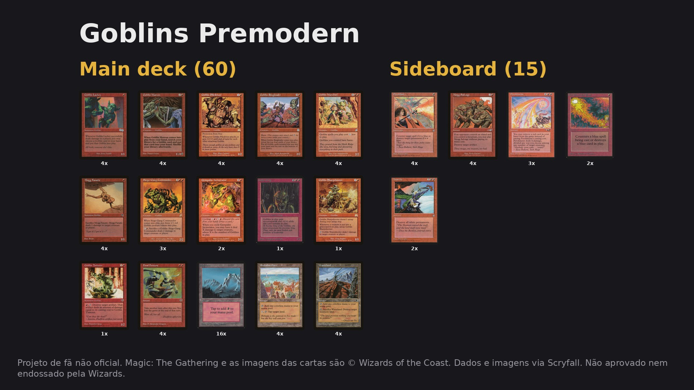
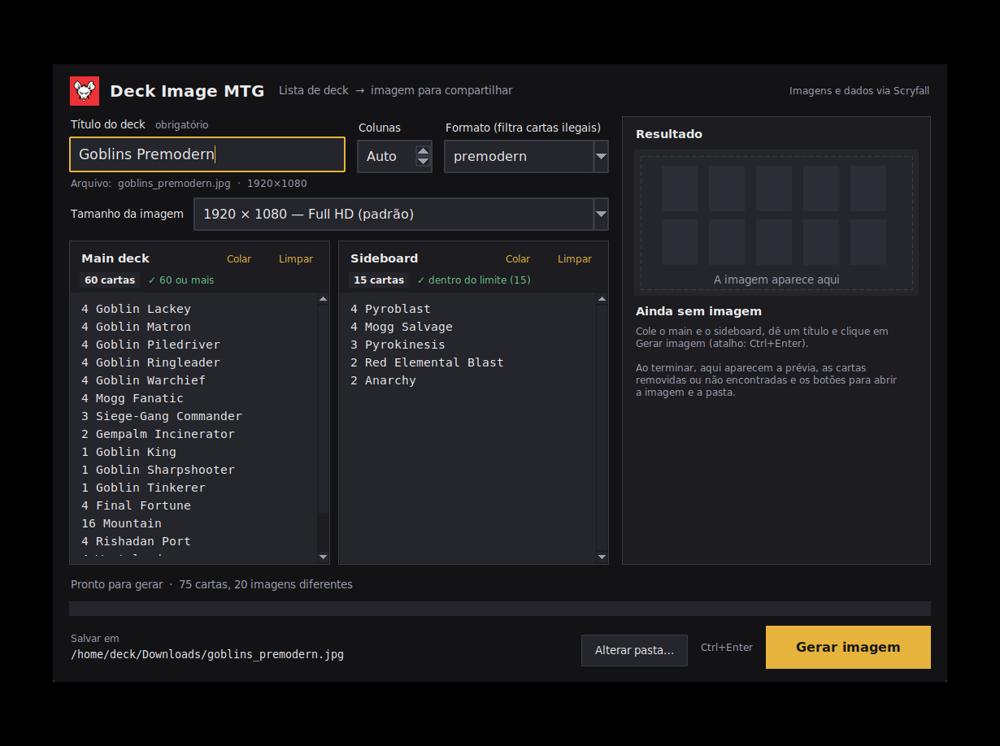
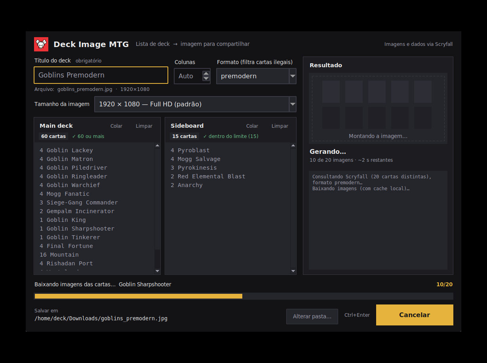
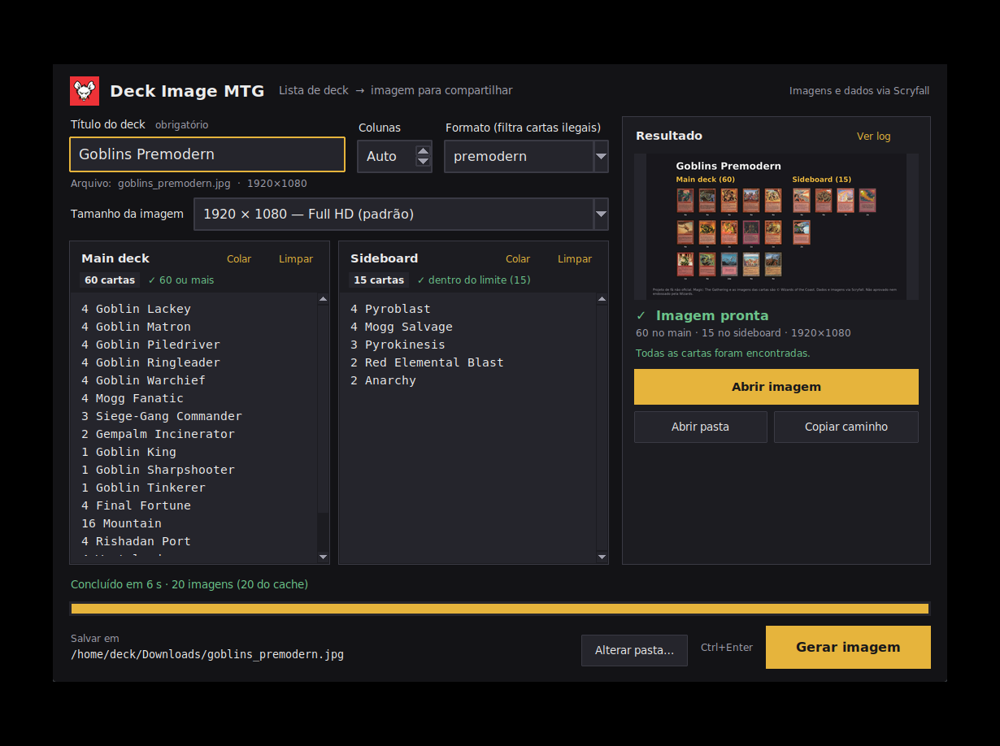
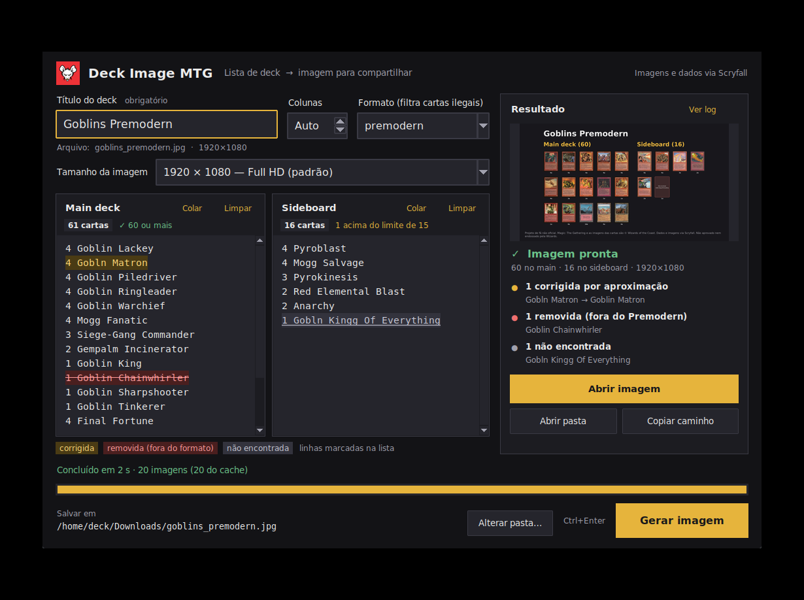

# DeckImageMTG

App desktop gratuito e de código aberto, para **Linux e Windows**. Você cola o **main deck** e o **sideboard**
de uma lista de Magic: The Gathering, ele busca as cartas no [Scryfall](https://scryfall.com/docs/api) e gera
uma imagem única na sua pasta **Downloads**, com o nome do deck: o título *Mono Green Elves* vira **`mono_green_elves.jpg`**.

O padrão é o formato **Premodern**, com a **primeira edição** de cada carta, de preferência com **borda preta**.



<sub>Lista de Goblins campeã do MTGO Premodern Online de 28/09/2026 (40 jogadores), publicada no
[Premodern Chronicles](https://premodernchronicles.com/decks/goblins-mtgo-premodern-online-2026-09).
Está em [`docs/exemplo-goblins.txt`](docs/exemplo-goblins.txt); para reproduzir:
`python run.py --main docs/exemplo-goblins.txt --title "Goblins Premodern"`. A imagem sai em 1920×1080 (Full HD);
para postar no Instagram, use `--size 1080x1350` ([exemplo](docs/exemplo-goblins-instagram.jpg)).</sub>

> **Projeto de fã não oficial.** Magic: The Gathering, seus logos e as imagens das cartas são © Wizards of the Coast.
> Este projeto não é aprovado nem endossado pela Wizards of the Coast. Dados e imagens via Scryfall.
> Uso livre e gratuito, conforme a [Fan Content Policy](https://company.wizards.com/en/legal/fancontentpolicy).

---

## Como executar

### Opção 1: baixar o executável (sem instalar nada)

1. Abra a página de [**Releases**](../../releases/latest).
2. Baixe o arquivo do seu sistema:
   - **Windows:** `DeckImageMTG.exe`
   - **Linux:** `DeckImageMTG`
3. Rode:
   - **Windows:** dê dois cliques no `.exe`. O executável não é assinado, então o SmartScreen pode avisar:
     clique em *Mais informações* e depois em *Executar assim mesmo*.
   - **Linux:** no terminal, dentro da pasta onde o arquivo foi salvo:
     ```bash
     chmod +x DeckImageMTG
     ./DeckImageMTG
     ```

### Opção 2: rodar pelo código-fonte (Python)

Pré-requisito: **Python 3.10 ou mais novo**, com Tkinter.
- **Windows:** baixe em [python.org](https://www.python.org/downloads/). No instalador, marque *Add python.exe to PATH*
  e deixe marcada a opção *tcl/tk and IDLE*.
- **Linux:** o Python normalmente já vem instalado. Se faltar o Tkinter, instale `python3-tk` (Debian/Ubuntu),
  `python3-tkinter` (Fedora) ou `tk` (Arch).

**Linux / macOS**
```bash
git clone https://github.com/RSSPEREZ/mtg-deck-image.git
cd mtg-deck-image
python3 -m venv .venv
.venv/bin/pip install -r requirements.txt
.venv/bin/python run.py
```

**Windows (PowerShell ou Prompt de Comando)**
```bat
git clone https://github.com/RSSPEREZ/mtg-deck-image.git
cd mtg-deck-image
python -m venv .venv
.venv\Scripts\pip install -r requirements.txt
.venv\Scripts\python run.py
```

Sem `git`, use **Code → Download ZIP** aqui no GitHub e extraia a pasta.

---

## Como usar

### Pela janela

**1. Preencha.** Dê um **título** ao deck (obrigatório): ele aparece no topo da imagem e dá nome ao arquivo,
mostrado logo abaixo do campo. Cole o **main deck** à esquerda e o **sideboard** à direita. Os botões **Colar** e
**Limpar** ajudam no Steam Deck, e dá para colar a lista inteira no campo do main, com a linha `Sideboard` no meio.
Cada lista mostra a contagem de cartas e avisa se faltam cartas para 60 ou se o side passou de 15, nos formatos que
têm essas regras. Se quiser, ajuste o **tamanho da imagem** (padrão **1920×1080, Full HD**, o tamanho ideal para vídeo),
as **colunas** (*Auto* escolhe a que deixa as cartas maiores), o **formato** e a **pasta** de saída (*Alterar pasta…*).
O tamanho final aparece abaixo do título, junto do nome do arquivo.



**2. Gere.** Clique em **Gerar imagem** (ou **Ctrl+Enter**). A barra mostra a carta que está sendo baixada e o tempo
restante; o botão vira **Cancelar**, e cancelar não grava nada. As imagens ficam em cache, então gerar de novo é rápido.



**3. Pronto.** O painel **Resultado** mostra a prévia (clique para abrir) e os botões **Abrir imagem**,
**Abrir pasta** e **Copiar caminho**. *Ver log* mostra os detalhes técnicos.



**Quando algo não bate**, o resumo lista as cartas e as linhas ficam marcadas na própria lista:

- **corrigida** (âmbar): nome com erro de digitação, achado por aproximação (*Gobln Matron → Goblin Matron*);
- **removida** (riscada): fora do formato escolhido, não entra na imagem (*Goblin Chainwhirler* no Premodern);
- **não encontrada** (sublinhada): não existe no Scryfall; vira um espaço "Não encontrada" na imagem.

A marcação some assim que você edita a lista.



A imagem vai para a pasta Downloads (`~/Downloads` no Linux, `C:\Users\<você>\Downloads` no Windows).
O nome do arquivo sai do título: minúsculas, sem acentos, e o que não for letra ou número vira `_`
(*Goblins – Premodern* → `goblins_premodern.jpg`). Gerar de novo com o mesmo título **substitui** o arquivo anterior.

### Formato da lista

Funciona com o texto exportado por MTGO, Arena, Moxfield, MTGGoldfish e similares:

```
4 Goblin Lackey
4x Goblin Matron
2 Siege-Gang Commander (SCG) 107
16 Mountain

Sideboard
4 Pyroblast
SB: 3 Tormod's Crypt
```

- `4 Nome` ou `4x Nome`. Sem número, conta como 1 cópia.
- `(SET) número` fixa uma edição específica.
- Uma linha `Sideboard` manda o resto para o side, então dá para colar a lista inteira no campo da esquerda.
  O prefixo `SB:` também funciona.
- Linhas que começam com `//` ou `#` são ignoradas.
- Nomes com pequenos erros de digitação são corrigidos automaticamente, e a correção aparece no log.

### Pela linha de comando

```bash
python run.py --main deck.txt --side side.txt --title "Goblins"
```

| Opção | Padrão | Descrição |
|---|---|---|
| `--main` | — | arquivo `.txt` do main deck (pode conter a linha `Sideboard`) |
| `--side` | — | arquivo `.txt` do sideboard |
| `--title` | **obrigatório** | título no topo da imagem; também dá nome ao arquivo |
| `--format` | `premodern` | filtro de legalidade (`legacy`, `vintage`, `pauper`, `oldschool`… ou `none` para desligar) |
| `--size` | `1920x1080` | tamanho da imagem em pixels (`LARGURAxALTURA`, de 480 a 7680 por lado) ou `original` (veja abaixo) |
| `--cols` | `auto` | cartas por linha (`auto` ou um número, que vale para cada seção) |
| `--out` | `Downloads/<titulo>.jpg` | caminho da imagem gerada (ignora o nome derivado do título) |

Tamanhos prontos: `1920x1080` (Full HD), `1280x720` (HD), `2560x1440` (QHD), `3840x2160` (4K),
`1080x1080` (Instagram quadrado), `1080x1350` (Instagram retrato 4:5), `1080x1920` (Stories 9:16) e `original`
(largura pelas colunas, 8 por padrão, altura livre, cartas sempre em 488×680). A janela oferece os mesmos tamanhos.

O comando retorna código `1` quando alguma carta não foi encontrada ou ficou fora do formato.

---

## Regras de geração

- **Formato (padrão Premodern):** cartas banidas ou que não são legais no formato **não entram na imagem**
  e são listadas no aviso final. A opção *(sem filtro)* ou `--format none` desliga o filtro.
- **Edição:** carta sem edição na lista usa a **impressão mais antiga com borda preta** (em papel, legal no
  formato, sem promo, sem Collectors' Edition), porque a borda branca contrasta demais com o fundo escuro.
  Na prática, Lightning Bolt e os terrenos básicos saem da Alpha, e Fyndhorn Elves sai da Ice Age.
  - Se a carta só existir com borda branca, vale a impressão mais antiga de todas.
  - Para escolher outra edição, escreva `(SET) número` na linha.
- **Layout:** cada carta aparece uma vez, com a quantidade embaixo (`4x`). Main deck e sideboard ficam em
  seções separadas, cada uma com seu total.
- **Tamanho fixo:** a imagem sai exatamente no tamanho escolhido. No modo *Auto*, o layout escolhe as colunas
  (e, se couber, põe o sideboard ao lado do main) para deixar as cartas o maior possível, e centraliza o conjunto.
  A carta nunca passa de 488×680 (o tamanho da imagem do Scryfall); com poucas cartas num tamanho grande, sobra fundo.
  Decks grandes em tamanhos pequenos deixam as cartas pequenas, e o programa avisa.
- As cartas **nunca recebem nada desenhado por cima**, e o texto de copyright continua visível. Quando o tamanho
  escolhido exige, elas são **reduzidas** proporcionalmente (sem cortar nem distorcer); nunca são ampliadas.
  Os cantos são arredondados com o raio medido em cada imagem (a Alpha tem cantos mais redondos).

## Respeito à API do Scryfall

O Scryfall é mantido de graça para a comunidade, e o app segue as
[regras de uso da API](https://scryfall.com/docs/api):

- Todas as requisições levam `User-Agent: DeckImageMTG/<versão>` e `Accept`.
- No mínimo **100 ms entre quaisquer requisições** (API e imagens), ou seja, menos de 10 por segundo.
  Se vier um HTTP 429, o app espera e tenta de novo.
- As cartas são buscadas **em lote** (`/cards/collection`, 75 por chamada, mais um `/cards/search` com `prefer:oldest`),
  em vez de uma chamada por carta. Um deck de 75 cartas costuma usar cerca de 3 chamadas à API mais as imagens.
- As imagens ficam em **cache local**, então gerar a mesma lista de novo não baixa nada:
  - Linux: `~/.cache/deckimage-mtg/`
  - Windows: `%LOCALAPPDATA%\deckimage-mtg\`

  Para liberar espaço, basta apagar essa pasta.

---

## Gerar os executáveis

- **Linux:** `./build_linux.sh` gera `dist/DeckImageMTG`.
- **Windows:** `build_windows.bat` gera `dist\DeckImageMTG.exe`.
- **GitHub Actions:** ao enviar uma tag `v*` (ex.: `git tag v1.1 && git push origin v1.1`), o workflow
  `.github/workflows/build.yml` gera os dois executáveis e publica uma Release com eles.

O PyInstaller não faz build cruzado: o `.exe` precisa ser gerado no Windows ou pelo Actions.

## Estrutura

```
run.py                 ponto de entrada (sem argumentos abre a janela; com argumentos, modo linha de comando)
deckimage/decklist.py  leitura da lista
deckimage/scryfall.py  cliente da API (rate limit, headers, lote, cache)
deckimage/build.py     resolução das cartas, filtro de formato, cálculo do layout (tamanho/colunas) e montagem da imagem
deckimage/app.py       ponto de entrada e linha de comando
deckimage/gui.py       janela (Tkinter/ttk, tema escuro)
tests/                 testes (pytest) do layout e da linha de comando
deckimage/assets/      ícone da janela e do executável (logo do Groselha Crew)
```

## Contribuindo

Issues e pull requests são bem-vindos: bugs, novos formatos de lista, opções de layout, traduções.
Rode os testes com `pip install -r requirements-dev.txt && pytest -q`.
Mantenha o respeito às regras do Scryfall (rate limit, headers, nada de chamadas por carta em loop)
e à Fan Content Policy (nada de logos oficiais nem de cobrar pelo acesso às imagens).

## Licença

Código sob a [licença MIT](LICENSE). A licença cobre só o código-fonte: as imagens e os dados das cartas
pertencem à Wizards of the Coast e são fornecidos pelo Scryfall. O ícone do app é o logo do
[Groselha Crew](https://groselhacrew.com.br) e não faz parte da licença MIT.
